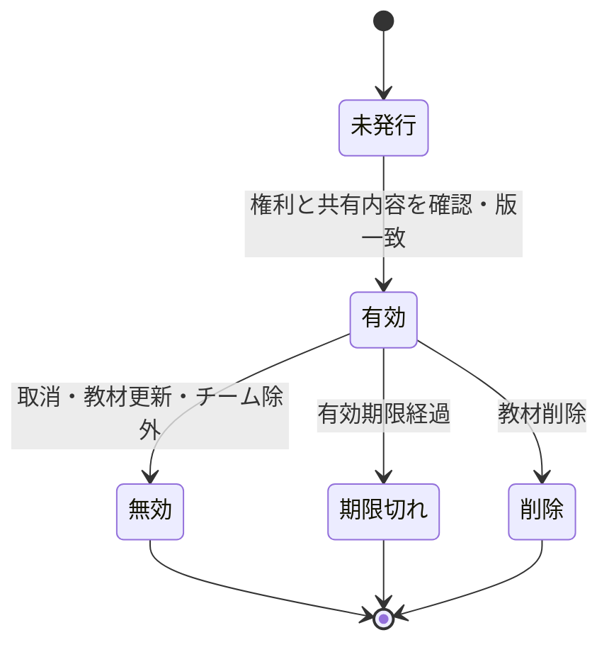

# 保管庫の機能マップと検証記録

確認日: 2026年11月23日（日本時間）。個人プロジェクト用の開発環境で、架空データのみを使用。

土台: `main` の `5bbd90af9835fa1df3c6de00ce6c94b197e5bcef`。開発ブランチ: `feat/private-team-vault`。

## 機能マップ

| 利用者の目的 | 入口 | 確認する境界 |
| --- | --- | --- |
| 自分の教材を保存 | `/signup` → `/vault` → 個人保管庫 → 教材保存 | 本人以外は本文も添付も取得できない |
| チームで使う | `/vault` → チーム作成 → 登録IDを指定して招待 → 指定相手がログインして受諾 | 管理者だけ招待・除外可能、招待は指定アカウント限定・期限付き一回限り |
| 探して編集 | 保管庫の検索 → 教材詳細 → 編集 | 他人の保管庫を拒否、古い版の上書きを拒否 |
| 素材を確認 | 教材詳細 → 素材・権利の確認メモ | 根拠と未検査を表示、適法性を断定しない |
| 読む人へ共有 | 教材詳細 → 内容・注意を確認 → 閲覧リンク発行 | 教材単位、期限付き、編集不可、権利メモ・チーム情報を除外 |
| 共有を止める | 教材詳細 → リンク無効化 | 本文・添付とも即時拒否、更新・削除・チーム除外でも失効 |

チームのメンバーは教材の閲覧・編集・削除・共有が可能です。チームの共通ID・共通パスワードを配布する設計ではありません。

## 閲覧リンク1本の状態

古い版の画面から最新の未確認教材を共有する操作は拒否します。既存リンクを再有効化せず、更新後は確認して新しいリンクを発行します。リンクの取消は、取得済みファイルを遠隔削除するものではありません。

## 検証結果

| 検証 | 結果・実施範囲 |
| --- | --- |
| `pnpm test` | 64件成功。復元11件・招待先固定3件を含む。認証・認可・期限・失効・版競合・永続化・添付制限・権利候補・ZIP制限等 |
| `pnpm check:boundaries` | 13件成功＋実ソース検査成功。クライアントからサーバー処理への依存、public内の私有ファイル、一部の秘密形式 |
| `pnpm lint` | 成功 |
| `pnpm exec tsc --noEmit` | 成功 |
| `pnpm build` | 本番ビルド成功 |
| Playwright | 本番ビルドのローカル起動で7シナリオ成功、失敗・スキップ0件 |
| 本番依存の監査 | Next.js 16.4.6と関連依存へ更新後、既知の通知0件（この確認時点・本番依存のみ） |
| 既存静的版チェック | 16 HTMLファイルの検査成功 |
| 独立レビュー | 実装担当と別のCodex担当が認証再確認・入力保持・非同期結果の競合・版確認・XML走査を確認。dotsちゃん自身の再確認とは別 |

ブラウザ検証は、登録→個人教材とTXT添付保存→権利候補表示→匿名共有閲覧・取得→取消→更新失効→検索→ログアウト・再ログイン、およびチーム招待→共同編集→メンバー除外→直接アクセス・共有の失効を確認しています。

本番モードの実HTTP応答で、共有ページの `no-store`・`no-referrer`・`noindex`、添付の `attachment`・`nosniff`、匿名・権限外アクセスの拒否を確認しました。Next.js開発モード固有のキャッシュ応答を本番確認の代用にはしていません。

画面はChromiumの375×812px表示を確認し、横スクロールが発生しないことを検査、スクリーンショットを目視確認しました。iPhone実機・Safariの確認とは区別します。

ローカル証拠: `test-results/e2e-results.json`、`test-results/.last-run.json`、`test-results/vault-mobile.png`、`test-results/vault-team-mobile.png`。E2EのDB・証拠はGitに含めず、CIでは架空データの証拠を7日間のartifactとして保存する定義です。

## 見つかった問題と再発防止

| 問題 | 修正・検査 |
| --- | --- |
| 古い画面で確認後に別メンバーが教材を更新すると、未確認の最新版を共有できる | 共有に確認した版を必須化。版不一致は409で拒否し、自動テストに追加 |
| 別タブでアカウント変更やチーム除外後、履歴から旧教材が再表示される | 復帰・認証変更ごとに現在のユーザーと閲覧権限を再確認し、確認前・失敗時は非表示。履歴復帰の回帰テスト |
| 古い削除画面から最新版を消せる | 削除にも版を必須化し、競合時は本文・添付・共有を保持して409で拒否 |
| RSC再検証後に旧版の共有チェックが引き継がれる | 教材ID・版ごとに共有フォームを再作成し、確認と旧リンク表示を初期化 |
| 破損したOffice XMLのタグ除去が二次時間になる | タグ・属性・entity等を後戻りしない走査へ変更。小さな不正fixtureを未検査通知にする回帰テスト |
| 古い編集画面からチーム教材を上書きできる | 更新する版をトランザクション内で照合し、本文・添付を保持して拒否するテスト |
| 除外されたメンバーが、以前知った未使用招待で戻れる | メンバー除外時に未使用招待も無効化し、自動テストに追加 |
| 土台のNext.js 16.2.10等に既知の脆弱性通知がある | Next.js 16.4.6へ更新し、関連依存も修正版へ揃え、CIに本番依存の監査を追加 |
| publicディレクトリ自体がsymlinkだと境界チェックが見逃す | 起点のsymlinkも辿らず拒否するよう修正し、回帰テストを追加 |
| 画面側から将来DB処理を誤って呼ぶ可能性 | 型だけのimportは許可し、実行時依存は間接呼び出しも含め境界チェックで拒否 |

## マージ前レビュー修正のテスト順

Issue #10 とPR #9のレビュー対象 `d0a62b6` に対し、別タブのアカウント変更・チーム除外・古い削除・共有確認の4つのE2Eが、旧本番ビルドで狙った失敗になることを先に確認しました。編集セレクタの初回不備は不具合再現に数えず、修正して失敗を取り直しています。削除の版確認2件、200byte未満の破損XML6件も、実装前に失敗を確認しました。

修正後は上記4件と既存2件のE2Eを成功させました。新しい表示境界について、通信エラー時に内容が隠れ、再試行後も未保存入力を保持する追加1件も成功しています。headless環境ではwindowのfocusイベントを明示dispatchして検査しており、OSの実フォーカス通知を保証する試験とは区別します。この追加確認は、旧実装への4件のREDとは区別しています。XMLは構造上の単方向走査を別担当が確認し、大規模入力やアップロード経路の負荷試験は行っていません。既存の容量・展開上限を含む単体50件は、全件成功・スキップ0件です。

ローカルのRED記録は `/tmp/spl-regression-red-evidence` と `/tmp/spl-regression-red-forms`、GREEN記録は `test-results` にあります。

## 開発方法との照合と残件

Lauren Tan講演を参考にした既存の運用案を履歴から確認し、このリポジトリ向けの短い手順をルートの `AGENTS.md` に記録しました。以前作成された正式なルール原本そのものは未取得なので、完全一致・完全準拠とは断定しません。

今回の機能実装すべてがテスト先行だったわけではありません。後から追加した検証と区別します。追加の境界チェックは、実装ファイルがない状態で11件の失敗を確認し、実装後に追加テストを含め12件の成功を確認しました。その後、独立レビューが見つけたpublic起点のsymlink見逃しも、再現テストの失敗→修正→13件成功の順で確認しました。

`.github/workflows/vault-checks.yml` にPR・push時の自動検証を定義しました。初回コミット `d0a62b6` のGitHub CIは成功しています。今回の修正コミットの実行結果はPR #9に記録します。必須チェック設定は変更していません。定義の存在をCI合格とは扱いません。自動マージ・配備処理は含めていません。

保存先はビルド出力への同梱対象から除外し、実行時の非公開永続ディスクを使います。

公開前は、アカウント回復・削除、登録・総容量制限、HTTPS・永続ディスク、自動バックアップ・復旧・監視、利用条件、dotsちゃん自身の確認とコウヤさんの判断を残します。

画像ロゴ識別・OCR・PDF本文・他作品との類似照合は未実装です。添付のOffice実アプリ上の編集・印刷品質も、今回のブラウザ検証では確認していません。

## Issue #11: 招待先の固定・別保存先への復元

招待は登録済みIDを指定して発行し、内部ではアカウントIDに固定します。別アカウントの受諾は拒否し、その試行で招待を消費しません。旧schemaはnullable列を追加し、宛先なしの旧招待は拒否します。教材・添付と所有者は移行で保持します。担当は先に3件の回帰テスト失敗を確認してから実装し、store全15件が成功しました。

新規の復元CLIは元バックアップを変更せず、新規の非公開保存先へコピーします。セッション・共有・招待を削除し、一般チーム所属を解除します。教材・添付・アカウント・所有者の内容を指紋で照合します。復元先の上書き、symlink・公開/Git領域、ジャーナル付き元DB、不明schema・整合性不良を拒否します。元DBがチェックアウト内の既定private保存先の場合は許容し、復元先はGit作業ツリー外を必須にします。

復元テストは実装ファイルがない状態で7件の失敗を確認しました。独立レビューで見つかった、未知の外部キーによる添付消失、schema名の除外条件によるtrigger見逃し、列順違いによるアプリ非互換も、それぞれ再現テストの失敗→修正の順で確認しました。元データの不変・保持対象とアクセス失効の処理後検査を追加し、追加の公開元パス検査を含め復元11件が成功。最終の単体全64件は成功・スキップ0件です。復元担当とは別のCodex担当が指摘修正を再確認し、招待・復元の変更範囲に残る必須指摘はありませんでした。

既存7件のブラウザ検証は新しい宛先入力に追従し、本番ビルドで成功しました。招待フォームを375px幅で表示し、横スクロールがないこととスクリーンショットを確認しました。追加予定だった招待転送のブラウザ検証は、担当サブエージェントが自動安全分類で停止したため未実施です。再依頼はせず、指定外アカウントの拒否・招待非消費は単体とコードで確認しています。この未実施分をブラウザ7件の合格には含めていません。

この復元は所有者とパスワードを過去の状態で保持します。本人確認・パスワード変更歴の確認・現在の所属照合は再開前に必要です。本番データの復旧や運用監視、自動停止検知を検証したものではありません。架空データ用の[試用手順・記録票](vault-trial.md)も追加しました。協力職員への連絡・実機iPhone/Office試用・本物の資料の移行・マージ・公開は実施していません。

Issue #11の最新GitHub CI結果はPR #9に記録します。以前の変更に対するdotsちゃんのコード・テスト結果の確認は履歴で確認できていますが、この追加変更についてdotsちゃん自身が確認済みとは報告しません。
